 

&nbsp;&nbsp;&nbsp;&nbsp;

 

## 👨‍💻 Sobre mim

Estudante de **Engenharia de Software na UCB** (CR 9.4) e estagiário na **Caixa Econômica Federal**.

Comecei no back-end com Java e Spring Boot e hoje estou migrando para **engenharia de dados**: SQL, Python, PySpark e Databricks.

Gosto de construir ferramentas que resolvem problemas reais, e uma delas já foi vendida e roda em produção.

 
 

## 🏅 Certificações

  
  
  

 

## 🧰 Stack

<table>
  <tr>
    <td align="center"><b>Dados</b></td>
    <td>  </td>
  </tr>
  <tr>
    <td align="center"><b>Back-end</b></td>
    <td></td>
  </tr>
  <tr>
    <td align="center"><b>Ferramentas</b></td>
    <td></td>
  </tr>
</table>

 

## 🚀 Projetos em destaque

<table>
  <tr>
    <td width="50%" valign="top">
      <h3>💰 Meu-Cofre</h3>
      App desktop de finanças pessoais. Importa extratos OFX e operações da B3, acompanha metas de aporte e projeta patrimônio. Mais de 800 testes e CI em Ubuntu e Windows.
        
      
      
      
       🔒 repositório privado
    </td>
    <td width="50%" valign="top">
      <h3>📨 Automação de Reclamações</h3>
      Recebe reclamações de clientes, gera o documento em PDF e envia por e-mail sozinho. <b>Vendido e em produção</b> numa empresa. Sendo reescrito de Apps Script para Python.
        
      
      
      
       🔒 código do cliente
    </td>
  </tr>
  <tr>
    <td width="50%" valign="top">
      <h3>🏠 <a href="https://github.com/Gabiue/real-estate-system">Real Estate System</a></h3>
      API REST de gestão imobiliária: clientes, imóveis e propostas comerciais.
        
      
      
      
    </td>
    <td width="50%" valign="top">
      <h3>📚 <a href="https://github.com/Gabiue/java-toolbox">Java-Toolbox</a> · <a href="https://github.com/Gabiue/java-drops">Java-Drops</a></h3>
      Referência prática da biblioteca padrão do Java (Strings, Regex, Collections, Streams, POO) e estudos diários de fundamentos.
        
      
    </td>
  </tr>
</table>

 

## 📈 GitHub

  
  

  
  

  

